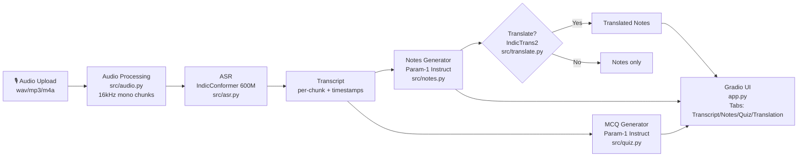

# Multilingual Lecture-to-Notes & Quiz Generator

> **CS3235 — CIE3 Lab Assessment** | Due: Nov 6  
> Uses India's sovereign AI models: IndicConformer · BharatGen Param-1 · IndicTrans2

---

## Problem Statement

Millions of students in India attend lectures in Hindi, Kannada, Tamil, and other regional languages. They struggle to take structured notes and generate practice questions from their native-language lectures. This project automates the entire pipeline—from raw audio to structured notes and MCQs—using open-source Indian AI models, with zero dependence on proprietary APIs.

---

## Architecture



---

## Model Choices & Justification

| Model | Task | Justification |
|-------|------|---------------|
| **IndicConformer 600M** (`ai4bharat/indic-conformer-600m-multilingual`) | ASR | State-of-the-art Indian multilingual ASR; covers 22 languages; open-weight; developed by AI4Bharat (IIT Madras) |
| **BharatGen Param-1 Instruct** (`bharatgenai/Param-1-2.9B-Instruct`) | Notes + MCQ | India's sovereign LLM; instruct-tuned for generation tasks; supports Hindi and English |
| **IndicTrans2 dist-200M** (`ai4bharat/indictrans2-*-dist-200M`) | Translation | Best-in-class Indic translation; distilled for T4 compatibility; 22-language coverage |

See [docs/MODEL_NOTES.md](docs/MODEL_NOTES.md) for verified checkpoint IDs, licenses, and usage code.

---

## Repo Structure

```
lecture-notes-quiz/
├── app.py                  # Gradio frontend
├── config.yaml             # All configurable values
├── requirements.txt
├── .env.example
├── src/
│   ├── audio.py            # 16kHz chunking
│   ├── asr.py              # IndicConformer wrapper
│   ├── notes.py            # Param-1 notes generation
│   ├── quiz.py             # Param-1 MCQ generation + Pydantic validation
│   ├── translate.py        # IndicTrans2 wrapper
│   ├── pipeline.py         # Orchestrator
│   ├── prompts.py          # All prompt templates
│   └── utils.py            # Config, logging, JSON repair
├── eval/                   # Evaluation suite
├── data/
│   ├── audio/              # Sample lecture clips
│   ├── reference_transcripts/
│   └── test_cases.csv      # 30 test cases
├── results/                # Metrics, charts, failure analysis
├── notebooks/colab_run.ipynb
├── docs/
│   ├── MODEL_NOTES.md
│   └── DEMO_SCRIPT.md
└── tests/                  # pytest (MOCK mode)
```

---

## Setup

### Local (CPU — development / MOCK mode)

```bash
git clone <your-repo-url>
cd lecture-notes-quiz

python -m venv .venv
# Windows:
.venv\Scripts\activate
# Linux/Mac:
source .venv/bin/activate

pip install -r requirements.txt

# Install FFmpeg for mp3/m4a decoding (Windows: `winget install Gyan.FFmpeg`;
# Linux: `sudo apt-get install ffmpeg`).

# Install IndicTransToolkit (only needed for translation):
pip install git+https://github.com/VarunGumma/IndicTransToolkit.git

# Run in MOCK mode (no GPU needed):
MOCK_MODELS=1 python app.py
```

Windows PowerShell:
```powershell
$env:MOCK_MODELS = "1"
python app.py
```

### Google Colab / Kaggle (T4 GPU)
For a temporary, internet-accessible web app, zip the `lecture-notes-quiz`
folder (do not include `.env`), upload `notebooks/colab_run.ipynb` to Google
Colab, choose **Runtime → Change runtime type → T4 GPU**, and add `HF_TOKEN` in
the Colab Secrets panel with notebook access enabled. Run the cells in order;
the notebook asks you to upload the project ZIP and prints a temporary
`gradio.live` URL. Open that link to use the app and upload audio there.

The Colab URL and model server stop when the runtime disconnects or is reclaimed;
this is not permanent hosting. The ASR and notes/quiz smoke tests are optional
and disabled by default so they do not delay publishing the web URL. Enable
them in their respective notebook cells if you want to test the models first.
The local `.env` is not uploaded; Colab reads the token only from its secret.

---

## Running the App

```bash
# MOCK mode (development, no GPU):
MOCK_MODELS=1 python app.py

# Real mode (requires accepted access to the gated ASR model and HF_TOKEN):
HF_TOKEN=hf_... python app.py

# With public share link (Colab):
python app.py --share

# Custom port:
python app.py --port 8080
```

Visit `http://localhost:7860` in your browser.

## Running ASR locally

The verified IndicConformer Hugging Face model is auto-gated. Accept its model
conditions on Hugging Face, then provide an access token through the environment.
The app loads `.env` from the project folder or its parent folder (where this
workspace's `.env` is located), without overriding variables already set in
the shell. Keep that file private; it is ignored by Git. In PowerShell:

```powershell
$env:HF_TOKEN = "hf_..."
$env:MOCK_MODELS = "0"
python -c "from src.asr import transcribe; print(transcribe(r'C:\path\to\lecture.wav', 'hi')['full_text'])"
```

`pip install -r requirements.txt` installs the model-card's ONNX Runtime CPU
packages. For a CUDA system, replace CPU ONNX Runtime with the model-card's
GPU package before running the smoke test:

```powershell
pip uninstall -y onnxruntime
pip install onnxruntime-gpu==1.20.1 onnx==1.20.1
```

IndicConformer documents an ONNX-backed custom `AutoModel` interface and does
not document a PyTorch fp16 option. The app uses its documented CTC call and
lets ONNX Runtime select its CUDA provider when installed; it does not force an
unsupported precision. If primary model access/loading fails, the configured
BharatGen Shrutam-2 fallback is attempted. Its model license is non-commercial;
its model card's setup uses Python 3.10.14, so use that runtime if the fallback
reports a Python/API compatibility error.

Real mode requires a sample audio file. The repository currently has no sample
clip; use a Hindi WAV/MP3/M4A file or upload one in the Gradio UI. Audio decoding
for MP3/M4A requires FFmpeg on `PATH`. The transcript smoke test can be run
independently of the downstream notes/quiz models:

```powershell
$env:HF_TOKEN = "hf_..."
python -c "from src.asr import transcribe; print(transcribe(r'C:\path\to\lecture.wav', 'hi'))"
```

## Running Notes and Quiz locally

Real notes and MCQ generation use the verified
`bharatgenai/Param-1-2.9B-Instruct` checkpoint. For example, after ASR has
produced a transcript:

```powershell
$env:MOCK_MODELS = "0"
$env:LLM_QUANTIZATION = "fp16"  # CPU works in float32; use int4 only with CUDA
python -c "from src.notes import make_notes, free_llm_memory; from src.quiz import make_mcqs; t='Newton first law describes inertia. An object remains at rest or in uniform motion unless a net external force acts on it. The second law relates net force to mass and acceleration. The third law says forces occur in equal and opposite pairs. These laws help explain motion.'; n=make_notes(t, 'en'); q=make_mcqs(n, 'en', transcript=t); print(n['markdown']); print(q.mcqs); free_llm_memory()"
```

The pipeline keeps Param-1 loaded between note and quiz generation, then frees
it. Long transcripts are reduced in token-bounded groups using
`context.max_input_tokens` and `context.map_reduce_chunk_size` from `config.yaml`.
MCQ generation validates the exact five-question JSON schema and transcript
evidence; it makes at most two repair attempts before surfacing a clear error.
4-bit/8-bit modes require CUDA and a compatible BitsAndBytes install; CPU
inference uses float32. T4 quantized loading has not yet been verified for this
checkpoint. See [docs/MODEL_NOTES.md](docs/MODEL_NOTES.md) for verified model
details and the unresolved license discrepancy.

---

## Running the Evaluation

```bash
# Run all evaluations:
python eval/run_all.py

# Individual evaluations:
python eval/wer_eval.py --test-cases data/test_cases.csv --transcripts-dir results/transcripts/
python eval/notes_eval.py --test-cases data/test_cases.csv --notes-dir results/notes/
python eval/mcq_eval.py  --test-cases data/test_cases.csv --quiz-dir results/quiz/
```

Charts are saved to `results/figures/`. Manual rating templates are in `results/*_ratings_template.csv`.

---

## Running Tests (MOCK mode)

```bash
MOCK_MODELS=1 pytest tests/ -v
```

The suite uses canned model responses and synthetic WAV samples, so it does not
need a GPU, HF token, or real lecture recording.

---

## Results Summary

> **TODO**: Fill in after running evaluation on real audio.

| Metric | Value |
|--------|-------|
| ASR WER (clean Hindi) | TODO |
| ASR CER (clean Hindi) | TODO |
| Notes keyword coverage (avg) | TODO |
| Notes factual consistency (manual avg) | TODO/5 |
| MCQ auto-validity (avg per sample) | TODO/5 |
| MCQ clarity (manual avg) | TODO/5 |
| Translation chrF (hi→en) | TODO |

See `results/failure_analysis.md` for failure analysis.

---

## Screenshots

> **TODO**: Add screenshots after taking them.

| | |
|--|--|
|  |  |
| Main UI | Interactive Quiz |

---

## Limitations

- **Language coverage**: Best quality for Hindi. Kannada and Tamil need more test data.
- **Memory**: T4 quantized loading is provided as an option but has not yet been verified for this checkpoint.
- **Noisy audio**: WER degrades significantly with background noise.
- **Context window**: Very long lectures (>30 min) trigger map-reduce which may lose nuance.
- **No speaker diarisation**: Multiple speakers are merged without attribution.

---

## Ethical Notes

- **Language coverage is unequal**: Hindi is best-supported; smaller Indian languages may underperform.
- **Accuracy caveats**: ASR and LLM errors can produce factually incorrect notes. Always verify against the original lecture.
- **Data privacy**: Audio is processed locally; nothing is sent to external APIs.
- **Not a replacement**: Generated notes and MCQs supplement, but do not replace, expert teaching.

---

## Manual TODO Before Submission

See the checklist at the end of this README.

---

## Checklist (Manual Steps Before Submission)

- [ ] Record or download 30 audio clips matching `data/test_cases.csv`
- [ ] Write reference transcripts in `data/reference_transcripts/`
- [ ] Run `python eval/run_all.py` and fill in results
- [ ] Manually rate notes (`results/notes_ratings_template.csv`)
- [ ] Manually rate MCQs (`results/mcq_ratings_template.csv`)
- [ ] Fill in `docs/MODEL_NOTES.md` with verified checkpoint details
- [ ] Take screenshots and add to `docs/screenshots/`
- [ ] Update Results Summary table above with real numbers
- [ ] Push to GitHub and add repo URL to submission form
- [ ] Record a 3-minute demo video following `docs/DEMO_SCRIPT.md`
